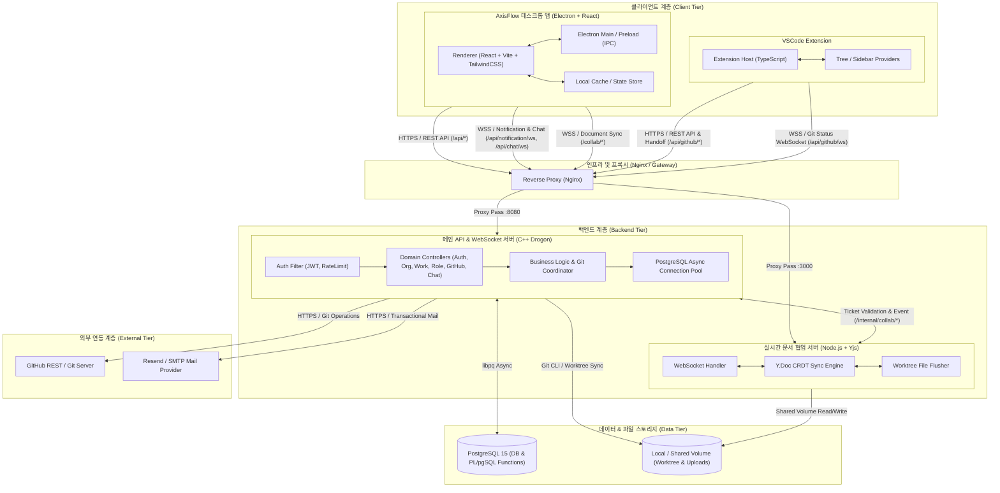
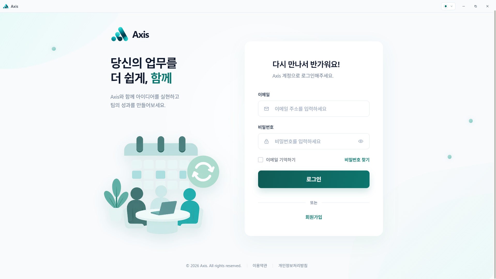
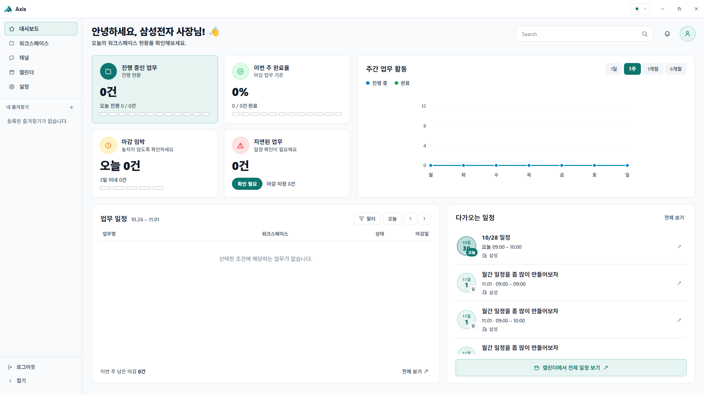
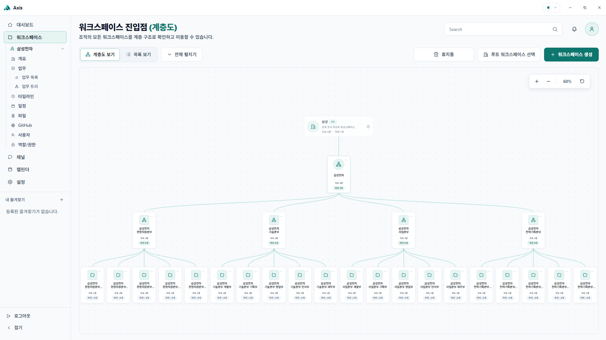
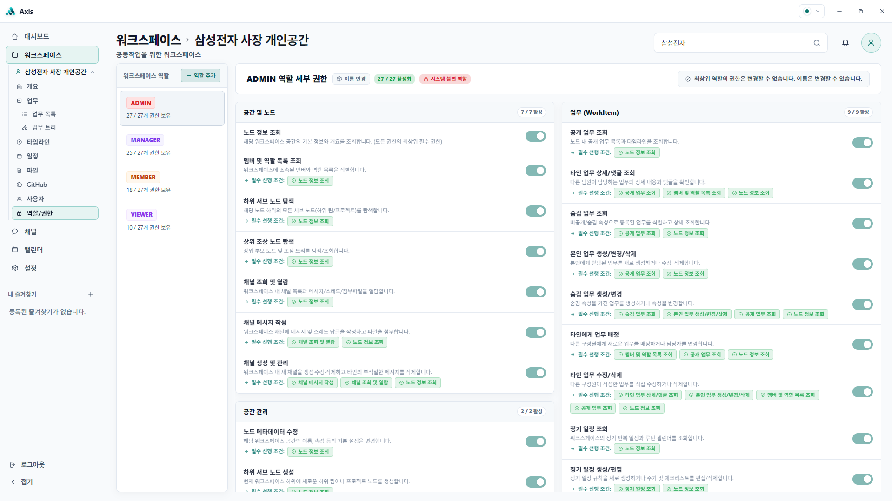
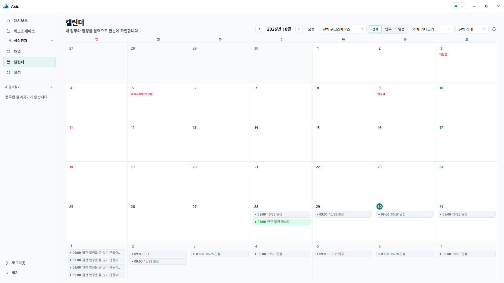
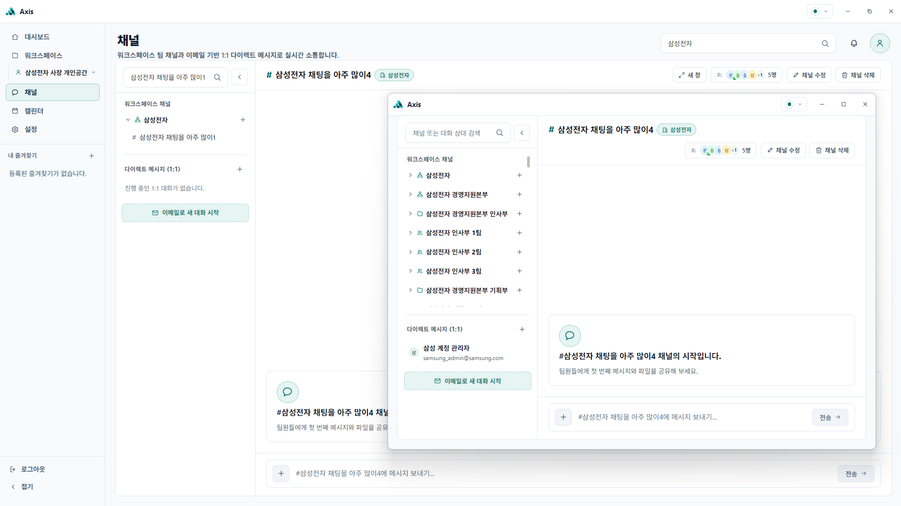
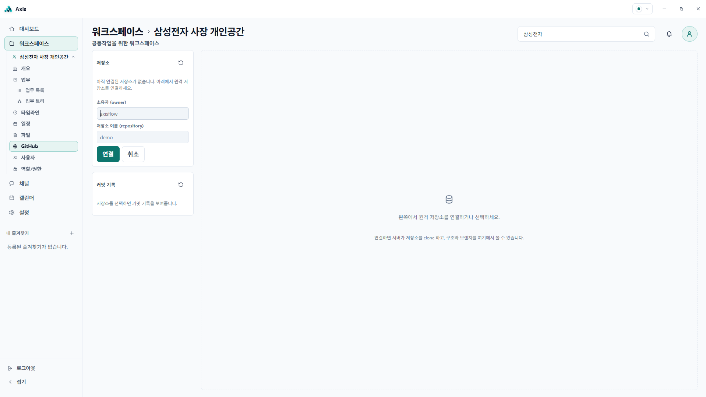
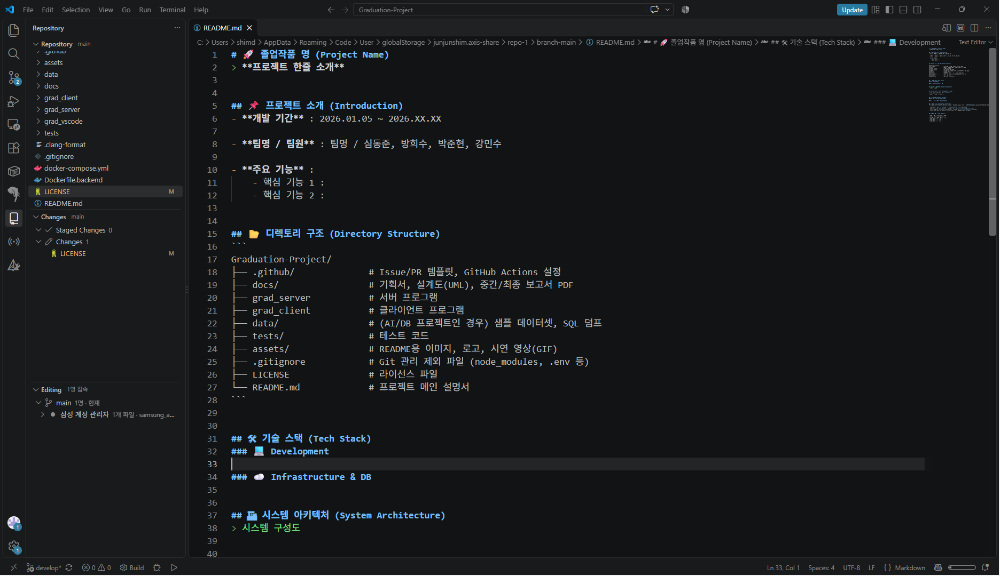

# 🚀 Axis
> 조직·업무·일정·소통·코드 협업을 하나의 흐름으로 연결한 통합 협업 플랫폼입니다.<br>
> 무한 확장형 계층 구조와 역할 기반 권한으로 팀별 공간과 업무를 유연하게 관리합니다.<br>
> GitHub·VSCode 실시간 편집을 연동해 기획부터 개발과 리뷰까지 끊김 없이 이어갑니다.


## 📌 프로젝트 소개 (Introduction)
- **개발 기간** : 2026.01.05 ~ 2026.10.28

- **팀명 / 팀원** : 팀명 / 심동준, 방희수, 박준현, 강민수

- **주요 기능** :
    - **계층형 워크스페이스**: 개인 공간부터 회사·부서·팀까지 하나의 트리로 관리하며 생성·이동·삭제·복구를 지원합니다.
    - **업무·일정 관리**: 프로젝트와 할 일을 계층형 업무로 관리하고 진행률 자동 집계, 타임라인, 반복 일정, 캘린더를 제공합니다.
    - **역할·권한 관리**: 워크스페이스별 역할과 세분화된 권한을 설정하고 상속·재정의 기반으로 접근을 통제합니다.
    - **채널·알림**: 워크스페이스 채널과 1:1 DM, 참여자 접속 상태, 활동 알림과 멘션을 제공합니다.
    - **파일·산출물 관리**: 워크스페이스와 업무에 파일을 첨부하고 다운로드하며 협업 산출물을 한곳에서 관리합니다.
    - **GitHub 연동**: 저장소 연결, 브랜치·Worktree 관리, 파일 탐색, 변경 상태 확인, Stage·Commit·Push, 커밋 그래프를 지원합니다.
    - **VSCode 실시간 협업**: Axis Share 확장으로 브랜치별 동시 편집, 원격 커서·선택 영역, 리뷰 데코레이션을 제공합니다.
    - **통합 대시보드**: 워크스페이스·업무·일정·활동 현황을 한 화면에서 확인합니다.


## 📂 디렉토리 구조 (Directory Structure)
```
Graduation-Project/
├── .github/               # Issue/PR 템플릿
├── assets/                # README용 이미지 및 시연 자료
├── data/                  # PostgreSQL 스키마, 함수, 트리거, 시드 SQL
├── deploy/                # Nginx, logrotate 등 배포 설정
├── docs/                  # API, 아키텍처, ERD, 설계 문서
├── grad_client/           # Electron 데스크톱 클라이언트
├── grad_collab/           # Yjs 기반 실시간 협업 서버
├── grad_server/           # C++ Drogon 백엔드 API 서버
├── grad_vscode/           # VSCode 확장 프로그램 Axis Share
├── tests/                 # 공용 테스트 디렉토리
├── uploads/               # 업로드 파일 저장 디렉토리
├── .clang-format          # C++ 코드 포맷 설정
├── .dockerignore          # Docker 빌드 제외 설정
├── .gitignore             # Git 관리 제외 설정
├── docker-compose.yml     # 전체 서비스 실행 구성
├── Dockerfile.backend     # 백엔드 실행 이미지
├── Dockerfile.backend.base # 백엔드 빌드 베이스 이미지
├── LICENSE                # MIT 라이선스
└── README.md              # 프로젝트 메인 설명서
```


## 🛠 기술 스택 (Tech Stack)
### 🧩 주요 기술 (Core Stack)

**Client & Extension**

[](https://www.electronjs.org/)
[](https://react.dev/)
[](https://www.typescriptlang.org/)
[](https://vite.dev/)
[](https://code.visualstudio.com/)

**Backend & Realtime**

[](https://isocpp.org/)
[](https://drogon.org/)
[](https://nodejs.org/)
[](https://yjs.dev/)
[](https://developer.mozilla.org/en-US/docs/Web/API/WebSockets_API)

**Data & Infrastructure**

[](https://www.postgresql.org/)
[](https://www.docker.com/)
[](https://nginx.org/)
[](https://aws.amazon.com/ec2/)
[](https://ubuntu.com/)
[](https://docs.github.com/en/rest)
[](https://letsencrypt.org/)
[](https://resend.com/)
[](https://jwt.io/)
[](https://www.openssl.org/)

### 💻 Development

| 구분 | 기술 | 사용 목적 |
| :--- | :--- | :--- |
| Desktop Client | Electron 30, React 18, TypeScript, Vite | Windows 데스크톱 애플리케이션 및 렌더러 UI |
| Client UI | React Router 7, CSS Modules | 화면 라우팅과 디자인 시스템 기반 UI 구성 |
| Backend | C++17/20, Drogon | REST API, WebSocket, 인증 및 GitHub·Git 연동 |
| Realtime Collaboration | Node.js 20, TypeScript, Yjs, ws | CRDT 기반 실시간 문서 동기화와 Worktree 파일 반영 |
| VSCode Extension | TypeScript, VS Code API, Yjs, esbuild | Axis Share 사이드바, 브랜치·리뷰·실시간 협업 기능 |
| Build & Quality | CMake, npm, Vite, ESLint, TypeScript Compiler | 플랫폼별 빌드, 정적 검사 및 테스트 |

### ☁️ Infrastructure & DB

| 구분 | 기술 | 사용 목적 |
| :--- | :--- | :--- |
| Database | PostgreSQL 15, PL/pgSQL | 계층형 데이터, 함수·트리거 기반 무결성 및 권한 관리 |
| Container | Docker, Docker Compose | 데이터베이스·백엔드·협업 서버 통합 실행 |
| Web Server | Nginx | 리버스 프록시, TLS 종료 및 WebSocket 업그레이드 |
| Hosting | AWS EC2, Ubuntu | 운영 서버 호스팅 |
| TLS | Let's Encrypt, Certbot | HTTPS 인증서 발급 및 자동 갱신 |
| Storage | Docker Volume, 공유 볼륨 | DB 데이터, Git 저장소·Worktree, 업로드 파일 보관 |
| Mail | Resend | 회원가입 이메일 인증 및 비밀번호 재설정 메일 |
| External Integration | GitHub REST API, Webhook, PAT | 저장소 연동, Git 이벤트 수신 및 원격 Push |

### 🔗 Protocol & Security

| 구분 | 기술 | 사용 목적 |
| :--- | :--- | :--- |
| API | REST, JSON | 클라이언트·확장 프로그램과 서버 간 통신 |
| Realtime | WebSocket, WSS | 알림, 채널, Git 상태 및 문서 편집 실시간 동기화 |
| Git | Git CLI, Git Worktree | 저장소 Clone, 브랜치 격리, Commit·Push 처리 |
| Auth | JWT Access·Refresh Token | 사용자 인증과 세션 갱신 |
| Authorization | 32비트 비트마스크 권한 | 워크스페이스별 역할 및 세분화된 접근 제어 |
| Encryption | OpenSSL, PostgreSQL pgcrypto | 토큰·GitHub PAT 등 민감 정보 보호 |


## 🏗 시스템 아키텍처 (System Architecture)
전체 시스템 구성과 계층별 상세 설계는 [시스템 아키텍처 설계서](docs/ARCHITECTURE.md)에서 확인할 수 있습니다.




## 📺 주요 화면 및 시연 (Screenshots & Demo)

### 🔐 로그인 및 대시보드

| 로그인 및 회원가입 | 통합 대시보드 |
| :---: | :---: |
| <a href="assets/Axis_로그인화면.png"></a> | <a href="assets/Axis_대시보드(화이트).png"></a> |
| 이메일 인증 기반 로그인·회원가입·비밀번호 재설정 | 진행 업무·완료율·지연 업무·주간 활동·다가오는 일정 |

### 🗂 워크스페이스 및 권한

| 워크스페이스 계층도 | 역할 및 권한 관리 |
| :---: | :---: |
| <a href="assets/Axis_워크스페이스(계층도).png"></a> | <a href="assets/Axis_워크스페이스(역할및권한).png"></a> |
| 무한 계층 구조 시각화·확대/축소·루트 워크스페이스 선택 | ADMIN·MANAGER·MEMBER·VIEWER 역할별 세부 권한 설정 |

### 📅 일정 및 소통

| 캘린더 | 채널 및 1:1 DM |
| :---: | :---: |
| <a href="assets/Axis_캘린더.png"></a> | <a href="assets/Axis_채팅(새창).png"></a> |
| 월간 업무·반복 일정·공휴일 통합 조회 | 워크스페이스 채널·실시간 접속자·별도 채팅 창 |

### 💻 GitHub 및 VS Code 협업

| GitHub 저장소 연동 | VS Code 실시간 협업 |
| :---: | :---: |
| <a href="assets/Axis_워크스페이스(GitHub).png"></a> | <a href="assets/Axis_vscode.png"></a> |
| 원격 저장소 연결·브랜치 및 파일 탐색·커밋 그래프 | 브랜치 단위 동시 편집·변경 상태·원격 커서·리뷰 데코레이션 |


## ⚙️ 시작하기 (Getting Started)
Axis는 별도 서버를 설치하지 않고 운영 서버(`https://axisflow.team`)에 연결해 사용합니다. Windows용 데스크톱 앱을 설치하고 VS Code 확장을 연결하면 바로 협업을 시작할 수 있습니다.

**운영 서버 상태:** [](https://axisflow.team/server-test)

> 운영 서버는 비용 문제로 중지될 수 있습니다. 상태가 `offline`이거나 확인 페이지에 접속되지 않으면 로그인, 데이터 동기화, GitHub 연동, 실시간 협업을 사용할 수 없습니다.

### 📋 요구 사항 (Prerequisites)

- Windows 10/11 (x64)
- Visual Studio Code `1.110.0` 이상
- 인터넷 연결
- Axis 계정 및 사용할 워크스페이스에 대한 접근 권한
- GitHub 비공개 저장소를 연결할 경우 해당 저장소에 접근할 수 있는 PAT(Personal Access Token)

### 🛠 설치 및 실행 (Installation)

1. [Visual Studio Code](https://code.visualstudio.com/)를 설치합니다.
2. [VS Code Marketplace의 Axis Share](https://marketplace.visualstudio.com/items?itemName=junjunshim.axis-share)에서 **Install**을 선택합니다.

   ```bash
   code --install-extension junjunshim.axis-share
   ```

3. 프로젝트 배포 페이지에서 Windows용 Axis 설치 패키지(`Axis-Windows-<version>-Setup.exe`)를 다운로드해 설치합니다.
4. Axis 앱을 실행하고 회원가입 또는 로그인합니다. 앱은 별도 설정 없이 운영 서버(`https://axisflow.team`)에 연결됩니다.
5. 비공개 저장소를 사용한다면 상단 사용자 메뉴에서 GitHub PAT를 등록합니다.
6. 워크스페이스의 **GitHub** 탭에서 사용할 저장소를 연결합니다.
7. **VSCode로 실시간 편집**을 선택하고, VS Code에서 연결 요청이 표시되면 허용합니다.

> Axis Share는 앱과 연결된 상태에서만 저장소를 엽니다. VS Code에서 확장을 단독으로 실행하면 이전 세션이 자동 복원되지 않으므로, 새 창에서 작업할 때는 Axis 앱에서 다시 **VSCode로 실시간 편집**을 실행하세요.


## 📝 협업 규칙 (Contribution Guidelines)
우리 팀의 효율적인 협업을 위해 다음 규칙을 준수합니다. 자세한 내용은 [CONTRIBUTING.md](.github/CONTRIBUTING.md)에서 확인하세요.

- **브랜치**: `main` <- `develop` <- `feature/기능명` 순으로 작업합니다.
- **커밋**: `태그: 설명` 형식을 유지합니다. (예: `Feat: 센서 데이터 수신 로직 구현`)
- **코드 스타일**: C++ Google Style Guide를 지향하며, 커밋 전 `Clang-Format`을 적용합니다.
- **PR**: 기능 완료 후 `develop` 브랜치로 PR을 날리고, 팀원의 리뷰를 거칩니다.


## 👥 팀원 역할 (Team Members)

| 이름 | 역할 | 담당 업무 |
| :--- | :--- | :--- |
| **심동준** | 팀장 | 프로젝트 기획·일정 및 요구사항 관리<br>시스템 아키텍처·DB·API 설계<br>백엔드 API·WebSocket·GitHub 연동<br>프론트 기능 통합, 테스트 및 배포 |
| **방희수** | 프론트 팀장 | 프론트엔드 구조·라우팅·상태 관리 설계<br>주요 화면 및 공통 컴포넌트 구현<br>API 연동과 프론트 코드 리뷰<br>화면 테스트 및 품질 개선 |
| **박준현** | 프론트 개발자, 서기 | 주요 화면·컴포넌트 구현<br>API 연동 및 UI 상태 처리<br>회의록 작성·공유<br>요구사항·변경사항 문서화 |
| **강민수** | 디자이너, 테스터 | 프론트엔드 UI/UX 설계<br>디자인 시스템·색상·타이포그래피·컴포넌트 스타일 정의<br>주요 화면 시안 제작<br>구현 화면의 디자인 검수 및 사용성 테스트 |
