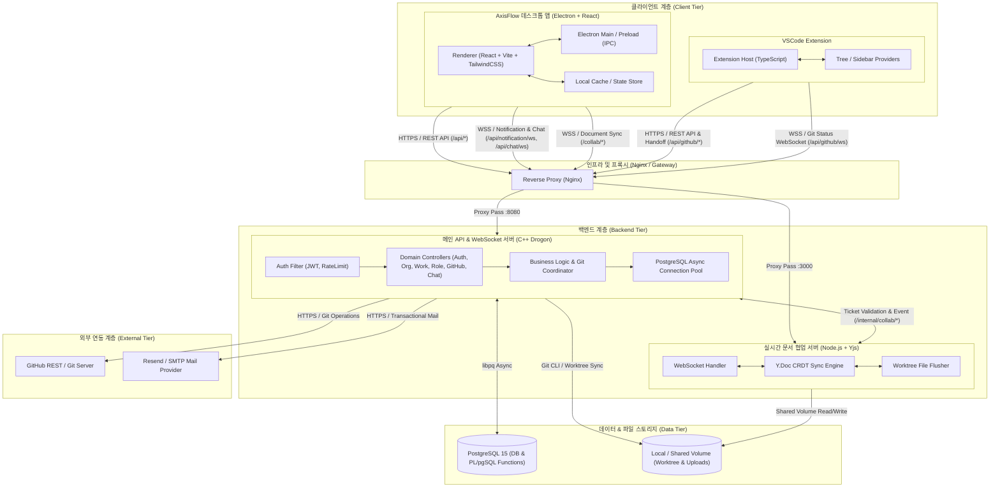

# 🏛️ 시스템 아키텍처 설계서 (System Architecture Specification)
**"OrganizationNode 기반 무한 확장형 계층 협업 플랫폼"**

---

## 1. 개요 및 시스템 목적 (System Overview)

본 시스템은 정형화된 조직 구조와 파편화된 협업 도구의 한계를 극복하기 위해 설계된 차세대 협업 및 업무 관리 플랫폼입니다.
- **조직과 공간의 일반화**: 회사, 부서, 팀, 개인 공간을 `OrganizationNode` 계층형 트리 모델로 일원화합니다.
- **업무 및 진행률 통합**: 대단위 프로젝트부터 하위 태스크까지 `WorkItem` 트리 구조로 관리하며 진행률(Progress)을 상향식으로 자동 롤업(Roll-up) 집계합니다.
- **세분화된 비트마스크 권한 통제**: 32비트 비트마스크(`authority_mask`) 기반의 동적 권한 제어 모델을 채택하여 워크스페이스별 자유로운 역할 커스터마이징을 지원합니다.
- **개발 환경과의 실시간 결합**: 데스크톱 클라이언트(Electron+React), VSCode Extension, 백엔드(C++ Drogon), 실시간 문서 동기화(Node.js Yjs), GitHub(브랜치 및 Worktree) 연동을 완결성 있게 결합합니다.

---

## 2. 전체 시스템 아키텍처 (High-Level Architecture)



---

## 3. 계층별 상세 구성 (Tier Architecture)

### 3.1. 클라이언트 계층 (Client Tier)

#### 1) 데스크톱 애플리케이션 (`grad_client`)
* **런타임**: **Electron + React 18 + TypeScript + Vite**
* **구조**:
  * **Main Process (`electron/main`)**: 시스템 트레이, OS 네이티브 윈도우 라이프사이클 관리, 안전한 토큰 보안 저장.
  * **Preload Script (`electron/preload`)**: 컨텍스트 격리(Context Isolation) 환경에서 안전한 브릿지 API (`window.electronAPI`) 노출.
  * **Renderer Process (`renderer/`)**:
    * `features/`: 도메인 단위 컴포넌트 (`auth`, `workspace`, `workItems`, `timeline`, `chat`, `github`, `routine`).
    * `design-system/`: 디자인 토큰 기반 UI 컴포넌트 (모든 스타일은 `theme.css` 토큰 참조 필수).
    * `network/`: Axios 기반 통신 어댑터 (`snake_case` API 응답 ↔ `camelCase` 프론트엔드 모델 자동 변환).
    * `realtime/`: WebSocket 클라이언트 (알림 피드, 채팅, 실시간 상태 동기화).

#### 2) VSCode 확장 프로그램 (`grad_vscode`)
* **런타임**: **Node.js (VSCode Extension Host API)**
* **역할**: 개발자가 에디터 내에서 워크스페이스 노드 트리, 할당된 업무(WorkItem), GitHub 브랜치를 직접 확인하고 작업 시작/전환.
* **통신 및 인증**:
  * 데스크톱 앱에서 원클릭으로 VSCode를 실행하는 핸드오프 프로토콜(`vscode://...` URI 스킴 및 60초 TTL 1회용 티켓) 지원.
  * 확장 전용 리프레시 토큰(`github_extension_tokens`)을 발급받아 데스크톱 앱 세션과 상호 간섭 없이 독립 세션 유지.

---

### 3.2. 프록시 및 게이트웨이 계층 (Gateway Tier)

* **컴포넌트**: **Nginx Reverse Proxy**
* **주요 역할**:
  * **SSL/TLS Termination**: 외부 클라이언트와의 암호화 통신 종단.
  * **HTTP/1.1 & WebSocket Upgrade**: `/api/notification/ws`, `/api/chat/ws`, `/api/github/ws`, `/collab/` 경로의 WebSocket 핸드셰이크 처리.
  * **응답 압축**: Brotli(`br`) 및 Gzip(`gzip`) 자동 압축 스트리밍.
  * **부하 분산 및 정적 라우팅**: 메인 C++ API 서버(`:8080`) 및 협업 Node.js 서버(`:3000`)로의 경로 분기.

---

### 3.3. 백엔드 서비스 계층 (Backend Tier)

#### 1) 메인 백엔드 API 서버 (`grad_server`)
* **프레임워크**: **C++17 Drogon Framework**
* **선정 사유**: 대규모 트리 노드 탐색 연산, 고빈도 WebSocket 이벤트 브로드캐스트, Git I/O 동시성 제어 시 극대화된 비동기 I/O 성능 및 낮은 메모리 오버헤드 보장.
* **핵심 컴포넌트**:
  * **Controllers**:
    * `auth`: 회원가입 이메일 인증, JWT 토큰 발급/회전, 비밀번호 재설정.
    * `org`: `organization_nodes` CRUD, 트리 이전(Move), 사전 유효성 검증.
    * `role`: 32비트 비트마스크 권한 정의 및 사용자 역할 할당 관리.
    * `work`: `work_items` 계층 관리, 자동 가중치 계산, 댓글/멘션/파일 첨부.
    * `recurring`: 정기 루틴/점검/미팅 규칙 스케줄링.
    * `chat`: 워크스페이스 토픽 채널 및 1:1 DM, 스레드 메시징.
    * `github`: 저장소 클론/Fetch/브랜치 생성, Git Worktree 제어, 커밋/Push 조율.
  * **Filters (`JwtFilter`, `RateLimitFilter`)**: 엔드포인트별 비트마스크 기반 인가 검증 및 요청 속도 제한.
  * **Async DB Connection Pool**: Drogon 비동기 PostgreSQL 드라이버(`orm::DbClient`)를 통한 논블로킹 트랜잭션 수행.

#### 2) 실시간 협업 사이드카 서버 (`grad_collab`)
* **프레임워크**: **Node.js + Yjs (CRDT Sync Engine)**
* **주요 역할**:
  * 다중 사용자가 동시에 작업 중인 파일에 대해 CRDT(Conflict-free Replicated Data Type) 기반 실시간 충돌 없는 동시 편집 지원.
  * **동기화 파이프라인**: 웹소켓을 통한 메모리 상태(`Y.Doc`) 동기화 → 디바운스된 파일 시스템 플러시(`FileFlusher`)를 통해 백엔드 공유 Worktree 로컬 파일에 원자적 반영.
  * **내부 인증 연동**: 메인 서버(`grad_server`)와의 `/internal/collab/*` 상호 검증을 통해 세션 무결성 유지.

---

### 3.4. 데이터 및 스토리지 계층 (Data & Storage Tier)

#### 1) PostgreSQL 15 RDBMS
* **중앙화된 비즈니스 무결성 (PL/pgSQL Functions & Triggers)**:
  * 비즈니스 로직(경로 계산, 상위 진행률 자동 갱신, 소프트 삭제 연쇄 처리, 감사 로그 기록)을 DB 저장 프로시저 및 트리거로 모듈화하여 데이터 일관성 보장.
* **32비트 비트마스크 (`authority_mask`)**:
  * `BIT(32)` 사용자 정의 도메인을 활용한 O(1) 비트 연산 기반 고속 권한 검사.
* **계층형 트리 최적화**:
  * Materialized Path (`path INTEGER[]`)에 GIN 인덱스를 적용하여 재귀 쿼리 비용을 최소화하고 하위 트리 일괄 조회 속도 극대화.
* **감사 및 롤백 지원**:
  * `activity_logs` 실시간 활동 피드 테이블과 `*_histories` 불변 스냅샷 테이블을 통한 변경 추적 및 복구 지원.

#### 2) 공유 볼륨 스토리지 (Shared Storage Volume)
* **`repository_data` 볼륨**:
  * 메인 백엔드(`grad_server`)와 협업 사이드카(`grad_collab`)가 공유 마운트.
  * Git 저장소의 로컬 베어(Bare) 클론 및 브랜치별 Git Worktree 격리 디렉터리 저장.
  * 유휴 브랜치 Worktree 자동 회수 스케줄러를 통해 디스크 공간 낭비 방지.
* **업로드 파일 스토리지**:
  * 업무 및 채팅 첨부파일을 격리 저장(UUID 기반 파일명 해싱, 원본명 및 MIME 타입 메타데이터는 DB 분리 관리).

---

## 4. 보안 및 권한 아키텍처 (Security & Authority Model)

```
       MSB (Bit 31)                                                 LSB (Bit 0)
      ┌──────────┬────────────────────────────────────────────────┬──────────┐
      │   DENY   │                도메인별 제어 비트               │NODE_VIEW │
      └──────────┴────────────────────────────────────────────────┴──────────┘
       (비트=1 이면                        ...                     (공간 조회의
        모든 권한 거부)                                             필수 기본 권한)
```

1. **32비트 비트마스크 권한 평가 (`authority_mask`)**:
   - `(user_mask & required_mask) == required_mask && !(user_mask & DENY_MASK)`
   - 단 한 번의 비트 연산으로 O(1)의 초고속 권한 검증 보장.
2. **토큰 분리 및 암호화**:
   - **Access Token**: 무상태(Stateless) JWT (유효기간 15분).
   - **Refresh Token**: DB 내 저장 및 원자적 토큰 회전(Rotation) 적용.
   - **GitHub Access Token (PAT)**: PostgreSQL `pgcrypto`의 `pgp_sym_encrypt` 대칭키 암호화 적용(서버 메모리에서만 복호화).
3. **네트워크 격리 및 서브넷 보호**:
   - DB(PostgreSQL) 및 내부 통신 포트는 호스트 외부 노출을 금지하고 Docker 내부 가상 네트워크에서만 접근 허용.
   - 메인 서버와 협업 사이드카 간 내부 통신(`/internal/*`)은 `INTERNAL_TOKEN` 사전 공유 키(PSK)로 상호 인증.

---

## 5. 장애 대응 및 데이터 무결성 보장 전략 (Reliability & Integrity)

1. **소프트 삭제 (Soft Delete) 및 연쇄 삭제**:
   - `is_deleted = TRUE` 플래그를 통한 논리 삭제. 상위 노드/업무 삭제 시 하위 엔티티 연쇄 비활성화.
   - 부모가 비활성화된 상태에서 자식 단독 복구 방지(`P0306` 등의 무결성 예외 처리).
2. **스냅샷 이력 기반 데이터 롤백 (`*_histories`)**:
   - 트리거를 통해 생성/수정/삭제 직전 상태를 히스토리 테이블에 스냅샷 형태로 기록하여 시스템 장애나 실수에 의한 데이터 유실 방지.
3. **Git 동시성 및 I/O 큐 제어 (Git Coordinator)**:
   - 무거운 Git CLI 연산(Clone, Fetch, Push) 시 서버 자원 고갈을 방지하기 위해 세마포어 기반 동시 실행 상한(`GIT_MAX_CONCURRENT`, `GIT_MAX_NETWORK`) 및 대기열(`GIT_MAX_QUEUED`) 적용.
4. **연결 복원력 (WebSocket Reconnect & Fallback)**:
   - 클라이언트 네트워크 단절 시 지수 백오프(Exponential Backoff) 기반 자동 재연결.
   - 재연결 성공 시 최신 타임스탬프 이후의 이벤트만 누락 없이 증분 동기화(Catch-up).
