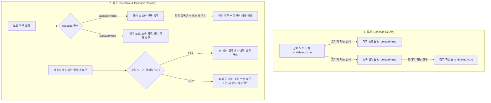

# 📌 데이터 라이프사이클 및 소프트 딜리트 / 복구 비즈니스 로직 정리

---

## 1. 기본 원칙 (Core Principles)

### ① 소프트 딜리트(`is_deleted`) 기반 가시성 제어
- **모든 엔티티(`NODE`, `WORK_ITEM`, `FILE`)는 `is_deleted: boolean` 필드를 응답에 포함**합니다.
- 서버 API(`context/init`, `get_node_detail`, `get_work_item_detail` 등)는 `is_deleted = true`인 항목도 권한이 있다면 클라이언트에 그대로 전달합니다.
- **클라이언트 UI 렌더링**:
  - **일반 화면(조직도/업무 보드/상세 뷰)**: `is_deleted === false`인 정상 항목만 필터링하여 렌더링
  - **휴지통 / 삭제된 항목 관리 탭**: `is_deleted === true`인 항목만 별도로 모아서 렌더링

---

### ② 삭제 상태 불변성 (Immutability) & 15일 만료 타이머
- **수정 불가 (Update Blocked)**:
  - `is_deleted = true` 상태인 객체는 **수정 API(`updateNode`, `updateWorkItem`, `updateRole` 등) 호출 시 변경이 차단**됩니다. (`400/403` 에러 반환)
- **`updated_at`의 의미 고정**:
  - 삭제된 이후 내용 수정이 불가능하므로, `updated_at`은 **"해당 객체가 삭제된 정확한 일시"**로 보존됩니다.
- **D-day 계산**:
  - 클라이언트는 `(updated_at + 15일) - 현재시간` 공식을 통해 **남은 복구 가능 기간(D-15 ~ D-Day, 시간 단위)**을 정확하게 계산하여 휴지통 UI에 카운트다운을 표시합니다.

---

## 2. 삭제(Delete) vs 복구(Restore) 정책

### ① 삭제 시: 연쇄 삭제 (Cascade Soft-Delete)
- **상위 노드 삭제 시**: 하위 자식 노드들, 소속된 모든 업무(`work_items`), 업무의 첨부파일(`work_item_files`)이 트리거에 의해 자동으로 `is_deleted = true` 처리
- **업무 삭제 시**: 하위 하위 업무(`parent_work_item_id`) 및 연결된 첨부파일(`work_item_files`)이 트리거에 의해 자동으로 `is_deleted = true` 처리

---

### ② 복구 시: 선택적 복구 vs 일괄 복구 (`cascade` 옵션)
복구 API는 `cascade: boolean` 파라미터를 지원하여 두 가지 사용자 경험을 모두 제공합니다:

1. **선택적 복구 (`cascade: false`, 기본값)**:
   - 대상 노드/업무만 단독으로 `is_deleted = false` 복구
   - 하위 노드나 소속 업무들은 삭제 상태(`is_deleted = true`)를 유지하여, 사용자가 원하는 항목만 골라서 복구 가능
2. **일괄 복구 (`cascade: true`)**:
   - 대상 노드/업무와 그에 속한 **모든 하위 자식/업무/첨부파일 트리 전체를 한 번에 일괄 복구**

---

### ③ 복구 시 상위 부모 생존 검증 및 부모 변경 복구 (Orphan 방지)
- **하위 노드 복구 시**: 상위 부모 노드(`parent_node_id`)가 `is_deleted = false`여야 복구 가능 (`P0306`)
- **업무 복구 시**: 
  - 소속 노드(`owner_node_id`)가 `is_deleted = false`여야 복구 가능 (`P0614`)
  - **새 부모 지정 복구 지원**: 기존 상위 업무가 삭제된 상태일 때, 새로운 살아있는 부모 업무(`parent_id`)를 지정하여 즉시 구출 복구 가능 (`P0615`, `P0616`)
- **파일 복구 시**: 소속된 업무(`work_item_id`)가 `is_deleted = false`여야 복구 가능 (`P0618`)

---

## 3. 15일 경과 시 자동 영구 삭제 (Hard Delete & Garbage Collection)

- **정리 대상**: `is_deleted = true`이고 `updated_at < CURRENT_TIMESTAMP - INTERVAL '15 days'`인 노드, 업무, 첨부 파일(`work_item_files`), 정기 일정 규칙(`recurring_rules`)과 그 첨부 파일(`recurring_rule_files`), 저장소 연결 해제 레코드
- **지우는 순서 (물리 파일 → DB 행)**: 되돌릴 수 있는 쪽이 먼저다.
  1. `list_expired_deleted_paths()` 로 만료 대상의 **물리 경로만** 모은다 — 아무것도 지우지 않는다
  2. 서버가 디스크에서 지운다 — `uploads/`(업무·정기 일정 첨부)·`repository/` 접두사 밖은 건드리지 않는다(DB 값이 오염돼도 안전)
  3. 지우지 못한 항목의 id 를 `purge_expired_deleted_data(failed_file_ids, failed_repo_ids, failed_recurring_file_ids)` 로 넘겨 **성공한 행만** `DELETE`
- **재시도**: 순서를 뒤집으면(행을 먼저 지우면) 파일 삭제에 실패한 경로를 다시 알 수 없어 영구 잔여물이 된다. 지금 구조에서는 실패한 항목의 행이 남아 **다음 회차에 자동으로 다시 시도**된다.
- **경계 일관성**: 행 삭제(3단계)의 기준 시각을 경로 수집(1단계)보다 1시간 뒤로 미룬다. 두 단계 사이에 15일 경계를 갓 넘긴 행이 경로를 모은 적 없이 지워지는 것을 막는다.
- **CASCADE 보호**: 저장소를 지우면 브랜치·접속자·커밋 기록이, 업무를 지우면 댓글·파일 행이, 정기 일정 규칙을 지우면 첨부·체크리스트가, 노드를 지우면 그 아래 저장소 행과 정기 일정 규칙이 `ON DELETE CASCADE` 로 함께 사라진다. 그래서 지우지 못한 것에 걸린 상위 행은 purge 함수가 함께 남긴다.
- **실행 주기**: C++ Drogon 서버 기동 **60초 뒤 1회 + 이후 24시간마다**. `runEvery` 만 두면 배포로 프로세스를 다시 띄울 때마다 타이머가 처음부터 다시 세어져 하루보다 자주 배포하는 환경에서는 영영 실행되지 않는다. 실제 작업은 워커 스레드 + `WorkerLimiter`(§13.4)에서 돌아 IO 스레드를 막지 않는다.

---

## 4. 브랜치 worktree 회수 (Server-side Garbage Collection)

GitHub 연동(TASK_11 — `.antigravitycli/agent/tasks/TASK_11_SERVER_LOCAL_REPO_VSCODE.md` §13.8)에서는 **브랜치마다 `git worktree` 로 작업 디렉터리 사본**을 만든다. 이 사본은 사용자가 만든 데이터가 아니라 **서버가 만든 파생물**이다. 그래서 15일 만료 하드 딜리트와 달리 "오래 안 쓴 것부터 회수"한다.

- **회수 대상**: `repository/<node_id>/<repo_name>.worktrees/<branch_slug>` — 브랜치 작업 디렉터리. **브랜치 행과 커밋은 남는다**(clone 의 ref·오브젝트에 있으므로). 브랜치를 다시 열면 `ensureWorktree` 가 같은 자리에 되살린다.
- **회수 조건**(하나라도 걸리면 회수하지 않는다):
  - 기본 브랜치(clone 디렉터리 자체가 작업 트리라 지울 것이 없다)
  - 접속자가 있는 브랜치(하루 넘게 갱신되지 않은 접속 기록은 유령으로 보고 무시한다)
  - 최근 10분 안에 사용한 브랜치
  - 커밋하지 않은 변경(스테이징·수정·새 파일)이 남은 작업 트리 — 사용자 데이터라서 지우지 않는다
- **회수 대상이 아닌 것**: 리뷰 데코레이션(`reviews.json`)과 Yjs 영속화(`.ydoc`)는 작업 디렉터리 **밖**(`<repo>.collab/`)에 있다. 브랜치 삭제와 달리 회수는 이 둘을 지우지 않는다.
- **회수 규칙**: ① `last_used_at` 이 `WORKTREE_IDLE_DAYS`(기본 30일)보다 오래된 브랜치 ② 저장소당 작업 디렉터리가 `WORKTREE_MAX_PER_REPO`(기본 20개)를 넘으면 오래 안 쓴 것부터(LRU)
- **사용 시각 기록**: `github_branches.last_used_at` — 조회·편집이 모두 지나는 `resolveWorkDir` 와 제어 소켓 접속(`upsert_github_branch_presence`)이 갱신한다. 10분 안에 기록된 값은 다시 쓰지 않는다.
- **실행 주기**: **시작 60초 뒤 1회 + 이후 24시간마다**. 15일 만료 정리와 같은 스케줄러에서 돌지만 각 작업은 워커 스레드 + `WorkerLimiter`(§13.4)로 실행해 IO 스레드를 막지 않는다. (`runEvery` 만 두면 배포로 컨테이너를 다시 띄울 때마다 타이머가 처음부터 다시 세어져 영영 실행되지 않는다.)
- **잔여 디렉터리 자동 치유**: 회수 뒤 그 자리에 git 이 모르는 디렉터리가 남으면 `git worktree add` 가 거부하므로, 서버가 add 전에 치우고 `git worktree prune` 을 돌린다(`clearStaleWorktreeDir`).

---

## 5. 관련 엔드포인트 규격 매핑

| 기능 | Method | URL | 명세서 문서 |
| :--- | :--- | :--- | :--- |
| **노드 상세 조회** | `GET` | `/api/org/nodes?node_id={id}` | [`api/Get/node_detail.md`](api/Get/node_detail.md) |
| **노드 복구** | `PATCH` | `/api/org/nodes/restore` | [`api/Patch/node_restore.md`](api/Patch/node_restore.md) |
| **업무 복구** | `PATCH` | `/api/workItems/restore` | [`api/Patch/work_item_restore.md`](api/Patch/work_item_restore.md) |
| **파일 복구** | `PATCH` | `/api/workItems/files/restore` | [`api/Patch/file_restore.md`](api/Patch/file_restore.md) |
| **전체 초기 동기화** | `GET` | `/api/context/init` | [`api/Get/context_init.md`](api/Get/context_init.md) |
