# 🧭 협업 To-Do + Git 연동 시스템 DB 설계서 (ERD)
**"OrganizationNode 기반의 유연한 계층 구조 협업 플랫폼"**

## 1. 핵심 설계 철학
* **모든 주체는 노드(Node)다**: 개인, 팀, 프로젝트 등 협업의 모든 단위 공간은 `organization_nodes` 트리 구조로 추상화됩니다.
* **업무의 통합**: 상위 프로젝트부터 세부 태스크까지 `work_items` 하나로 관리하며 계층 구조(Parent-Child)를 형성합니다.
* **동적 권한 관리**: 32비트 비트마스크(`authority_mask`) 기반으로 워크스페이스별 커스텀 역할을 정의하고 권한을 유연하게 부여합니다.
* **통합 협업 환경**: 업무(WorkItem), 댓글/멘션, 파일, 정기 루틴(Recurring), 실시간 채팅(Workspace/DM), GitHub 연동(브랜치/Worktree/커밋)까지 DB 레벨에서 완결성 있게 관리합니다.

---

## 2. ERD 다이어그램 (Mermaid)

```mermaid
erDiagram
    organization_nodes ||--o{ organization_nodes : "parent_node_id"
    organization_nodes ||--o{ users : "personal_node_id"
    organization_nodes ||--o{ role_assignments : "node_id"
    organization_nodes ||--o{ role_authorities : "node_id"
    organization_nodes ||--o{ work_items : "owner_node_id"
    organization_nodes ||--o{ activity_logs : "node_id"
    organization_nodes ||--o{ recurring_rules : "owner_node_id"
    organization_nodes ||--o{ github_repositories : "node_id"
    organization_nodes ||--o{ github_handoff_codes : "node_id"
    organization_nodes ||--o{ chat_channels : "owner_node_id (WORKSPACE)"

    users ||--o{ role_assignments : "user_id"
    users ||--o{ work_items : "owner_user_id"
    users ||--o{ user_refresh_tokens : "user_email"
    users ||--o{ password_reset_tokens : "user_email"
    users ||--o{ activity_logs : "actor_user_id"
    users ||--o{ work_item_comments : "author_user_id"
    users ||--o{ comment_mentions : "mentioned_user_id"
    users ||--o{ work_item_files : "uploader_user_id"
    users ||--o{ recurring_rules : "creator/assignee"
    users ||--o{ recurring_rule_files : "uploader_user_id"
    users ||--o{ github_branches : "created_by_email"
    users ||--o{ github_branch_presence : "user_email"
    users ||--o{ github_commit_logs : "author/pushed_by_email"
    users ||--o{ github_user_credentials : "user_email"
    users ||--o{ github_extension_tokens : "user_email"
    users ||--o{ github_handoff_codes : "user_email"
    users ||--o{ chat_channels : "dm_user1 / dm_user2"
    users ||--o{ chat_messages : "sender_user_id"
    users ||--o{ chat_message_files : "uploader_user_id"
    users ||--o{ chat_channel_reads : "user_id"

    role_authorities ||--o{ role_assignments : "(node_id, role_id, is_top_role)"

    work_items ||--o{ work_items : "parent_work_item_id"
    work_items ||--o{ work_item_comments : "work_item_id"
    work_items ||--o{ work_item_files : "work_item_id"
    work_items ||--o{ github_branches : "work_item_id"
    work_items ||--o{ github_commit_logs : "matched_work_item_id"

    work_item_comments ||--o{ comment_mentions : "comment_id"

    recurring_rules ||--o{ recurring_rule_checklists : "rule_id"
    recurring_rules ||--o{ recurring_rule_files : "rule_id"

    github_repositories ||--o{ github_branches : "repo_id"
    github_repositories ||--o{ github_commit_logs : "repo_id"
    github_repositories ||--o{ github_handoff_codes : "repo_id"
    github_branches ||--o{ github_branch_presence : "branch_id"
    github_branches ||--o{ github_commit_logs : "branch_id"

    chat_channels ||--o{ chat_messages : "channel_id"
    chat_channels ||--o{ chat_message_files : "channel_id"
    chat_channels ||--o{ chat_channel_reads : "channel_id"
    chat_messages ||--o{ chat_messages : "parent_message_id (Thread)"
    chat_messages ||--o{ chat_message_files : "message_id"

    organization_nodes {
        int node_id PK
        varchar node_type
        int parent_node_id FK
        varchar name
        int_array path
        boolean is_deleted
        timestamp created_at
        timestamp updated_at
    }

    users {
        varchar user_id PK
        varchar email UK
        varchar name
        text password_hash
        int personal_node_id FK
        boolean is_deleted
        timestamp created_at
        timestamp updated_at
    }

    role_assignments {
        int assignment_id PK
        varchar user_id FK
        int node_id FK
        int role_id FK
        boolean is_top_role
        timestamp created_at
        timestamp updated_at
    }

    role_authorities {
        int authority_id PK
        int node_id FK
        varchar role
        bit32 authority
        boolean is_top_role
        timestamp created_at
        timestamp updated_at
    }

    work_items {
        varchar work_item_id PK
        int display_id
        int owner_node_id FK
        varchar parent_work_item_id FK
        varchar owner_user_id FK
        varchar title
        text description
        varchar category
        boolean hidden
        varchar status
        int priority
        int weight
        int progress
        boolean is_deleted
        date start_date
        date due_date
        timestamp created_at
        timestamp updated_at
    }

    chat_channels {
        int channel_id PK
        varchar channel_type
        int owner_node_id FK
        varchar name
        text description
        boolean is_default
        varchar dm_user1_id FK
        varchar dm_user2_id FK
        varchar created_by_user_id FK
        timestamp last_message_at
        boolean is_deleted
        timestamp created_at
        timestamp updated_at
    }

    chat_messages {
        int message_id PK
        int channel_id FK
        int parent_message_id FK
        varchar sender_user_id FK
        text content
        boolean is_edited
        boolean is_deleted
        timestamp created_at
        timestamp updated_at
    }
```

---

## 3. 도메인별 상세 테이블 명세

### 1) 조직 및 계층 구조 (Organization & Node)

#### `organization_nodes` (조직/공간 노드)
모든 공간(개인 노드, 워크스페이스, 부서/팀 등)의 계층형 트리 구조를 담당합니다.
| 컬럼명 | 타입 | 제약조건 | 설명 |
| :--- | :--- | :--- | :--- |
| `node_id` | SERIAL | PRIMARY KEY | 노드 고유 식별자 |
| `node_type` | VARCHAR(100) | NOT NULL | 노드 타입 (`USER`, `COMPANY`, `DEPARTMENT`, `TEAM` 등) |
| `parent_node_id` | INTEGER | REFERENCES organization_nodes(node_id) ON DELETE SET NULL | 상위 노드 ID (Self-referencing) |
| `name` | VARCHAR(100) | NOT NULL | 노드/조직명 또는 개인 공간명 |
| `path` | INTEGER[] | NOT NULL, GIN INDEX | 루트부터 현재 노드까지의 ID 경로 배열 (계층 쿼리 최적화) |
| `is_deleted` | BOOLEAN | NOT NULL DEFAULT FALSE | 소프트 삭제 여부 |
| `created_at` | TIMESTAMPTZ | DEFAULT CURRENT_TIMESTAMP | 생성 시각 |
| `updated_at` | TIMESTAMPTZ | DEFAULT CURRENT_TIMESTAMP | 수정 시각 |

---

### 2) 사용자 및 인증 (Users & Authentication)

#### `users` (서비스 사용자)
| 컬럼명 | 타입 | 제약조건 | 설명 |
| :--- | :--- | :--- | :--- |
| `user_id` | VARCHAR(50) | PRIMARY KEY | 유저 식별자 |
| `email` | VARCHAR(100) | UNIQUE NOT NULL | 계정 이메일 (정규화 인덱스 적용) |
| `name` | VARCHAR(100) | NOT NULL | 사용자 이름 |
| `password_hash` | TEXT | NOT NULL | 비밀번호 해시 |
| `personal_node_id` | INTEGER | REFERENCES organization_nodes(node_id) ON DELETE SET NULL | 개인 전용 노드 ID |
| `is_deleted` | BOOLEAN | NOT NULL DEFAULT FALSE | 탈퇴/삭제 여부 |
| `created_at` | TIMESTAMPTZ | DEFAULT CURRENT_TIMESTAMP | 가입 일시 |
| `updated_at` | TIMESTAMPTZ | DEFAULT CURRENT_TIMESTAMP | 정보 수정 일시 |

#### `user_refresh_tokens` (앱 리프레시 토큰)
| 컬럼명 | 타입 | 제약조건 | 설명 |
| :--- | :--- | :--- | :--- |
| `user_email` | VARCHAR(100) | PRIMARY KEY REFERENCES users(email) ON DELETE CASCADE | 사용자 이메일 |
| `refresh_token` | TEXT | NOT NULL | 리프레시 토큰 |
| `expires_at` | TIMESTAMPTZ | NOT NULL | 토큰 만료 시각 |
| `updated_at` | TIMESTAMPTZ | DEFAULT CURRENT_TIMESTAMP | 갱신 시각 |

#### `password_reset_tokens` (비밀번호 재설정 토큰)
| 컬럼명 | 타입 | 제약조건 | 설명 |
| :--- | :--- | :--- | :--- |
| `reset_id` | SERIAL | PRIMARY KEY | 재설정 요청 식별자 |
| `user_email` | VARCHAR(100) | NOT NULL REFERENCES users(email) ON DELETE CASCADE | 대상 사용자 이메일 |
| `token_hash` | CHAR(64) | NOT NULL UNIQUE | SHA-256 토큰 해시 |
| `expires_at` | TIMESTAMPTZ | NOT NULL | 만료 일시 |
| `used_at` | TIMESTAMPTZ | NULLABLE | 소비(사용) 일시 |
| `created_at` | TIMESTAMPTZ | NOT NULL DEFAULT CURRENT_TIMESTAMP | 발급 일시 |

#### `signup_email_verifications` (회원가입 이메일 인증)
| 컬럼명 | 타입 | 제약조건 | 설명 |
| :--- | :--- | :--- | :--- |
| `verification_id` | SERIAL | PRIMARY KEY | 인증 요청 식별자 |
| `email` | VARCHAR(100) | NOT NULL | 인증 대상 이메일 |
| `code_hash` | TEXT | NOT NULL | 6자리 인증코드 bcrypt 해시 |
| `code_expires_at` | TIMESTAMPTZ | NOT NULL | 인증코드 만료 시각 |
| `attempts` | INTEGER | NOT NULL DEFAULT 0 | 입력 시도 횟수 |
| `max_attempts` | INTEGER | NOT NULL DEFAULT 5 | 최대 허용 시도 횟수 |
| `verified_at` | TIMESTAMPTZ | NULLABLE | 인증 성공 시각 |
| `verification_token_hash` | CHAR(64) | UNIQUE | 회원가입 완료 검증용 토큰 SHA-256 해시 |
| `token_expires_at` | TIMESTAMPTZ | NULLABLE | 검증 토큰 만료 시각 |
| `consumed_at` | TIMESTAMPTZ | NULLABLE | 회원가입 완료에 사용된 시각 |
| `created_at` | TIMESTAMPTZ | NOT NULL DEFAULT CURRENT_TIMESTAMP | 생성 시각 |

---

### 3) 권한 및 역할 관리 (Roles & Authorities)

#### `role_authorities` (노드별 역할 및 권한 정의)
| 컬럼명 | 타입 | 제약조건 | 설명 |
| :--- | :--- | :--- | :--- |
| `authority_id` | SERIAL | PRIMARY KEY | 역할 권한 정의 식별자 |
| `node_id` | INTEGER | NOT NULL REFERENCES organization_nodes(node_id) ON DELETE CASCADE | 귀속 노드 ID |
| `role` | VARCHAR(50) | NOT NULL | 역할명 (예: `Owner`, `Admin`, `Member`, `Viewer` 등) |
| `authority` | authority_mask (BIT(32)) | NOT NULL | 32비트 비트마스크 권한 |
| `is_top_role` | BOOLEAN | NOT NULL DEFAULT FALSE | 워크스페이스 최고 관리자(Owner) 역할 여부 |
| `created_at` | TIMESTAMPTZ | DEFAULT CURRENT_TIMESTAMP | 생성 시각 |
| `updated_at` | TIMESTAMPTZ | DEFAULT CURRENT_TIMESTAMP | 수정 시각 |

#### `role_assignments` (사용자-노드 역할 매핑)
| 컬럼명 | 타입 | 제약조건 | 설명 |
| :--- | :--- | :--- | :--- |
| `assignment_id` | SERIAL | PRIMARY KEY | 할당 식별자 |
| `user_id` | VARCHAR(50) | NOT NULL REFERENCES users(user_id) ON DELETE CASCADE | 사용자 ID |
| `node_id` | INTEGER | NOT NULL REFERENCES organization_nodes(node_id) ON DELETE CASCADE | 노드 ID |
| `role_id` | INTEGER | NOT NULL | 매핑된 역할 권한 정의 ID (`role_authorities.authority_id`) |
| `is_top_role` | BOOLEAN | NOT NULL DEFAULT FALSE | 최고 관리자 속성 검증용 내부 컬럼 |
| `created_at` | TIMESTAMPTZ | DEFAULT CURRENT_TIMESTAMP | 부여 시각 |
| `updated_at` | TIMESTAMPTZ | DEFAULT CURRENT_TIMESTAMP | 변경 시각 |

#### `authority_constants` & `role_defaults` (권한 상수 및 역할 기본값)
- **`authority_constants`**: 시스템에서 사용하는 비트 위치 정의 (`constant_id`, `name`, `bit_position`, `description`)
- **`role_defaults`**: 역할별 기본 비트마스크 정의 (`role`, `default_authority`, `is_top_role`)

---

### 4) 업무 관리 (WorkItems, Comments & Files)

#### `work_items` (업무 및 태스크)
| 컬럼명 | 타입 | 제약조건 | 설명 |
| :--- | :--- | :--- | :--- |
| `work_item_id` | VARCHAR(50) | PRIMARY KEY | 전역 업무 ID (예: `WI-101`) |
| `display_id` | INTEGER | NOT NULL | 노드 내 순번 표시 ID |
| `owner_node_id` | INTEGER | REFERENCES organization_nodes(node_id) ON DELETE SET NULL | 소속 워크스페이스/노드 ID |
| `parent_work_item_id` | VARCHAR(50) | REFERENCES work_items(work_item_id) ON DELETE SET NULL | 상위 부모 업무 ID (계층 구조) |
| `owner_user_id` | VARCHAR(50) | NOT NULL REFERENCES users(user_id) ON DELETE CASCADE | 업무 생성/담당 유저 ID |
| `title` | VARCHAR(200) | NOT NULL | 업무 제목 |
| `description` | TEXT | NULLABLE | 업무 상세 내용 |
| `category` | VARCHAR(50) | NULLABLE | 카테고리/유형 |
| `hidden` | BOOLEAN | NOT NULL DEFAULT FALSE | 숨김 처리 여부 |
| `status` | VARCHAR(20) | NOT NULL DEFAULT 'todo' | 상태 (`todo`, `in_progress`, `review`, `done`) |
| `priority` | INTEGER | NOT NULL DEFAULT 3 (1~5) | 우선순위 (1: 최하, 5: 긴급) |
| `weight` | INTEGER | NOT NULL DEFAULT 0 (0~100) | 상위 업무 진행률 기여 가중치(%) |
| `progress` | INTEGER | NOT NULL DEFAULT 0 (0~100) | 진행률(%) |
| `is_deleted` | BOOLEAN | NOT NULL DEFAULT FALSE | 소프트 삭제 여부 |
| `start_date` | DATE | NULLABLE | 시작일 |
| `due_date` | DATE | NULLABLE | 마감일 (`due_date >= start_date`) |
| `created_at` | TIMESTAMPTZ | DEFAULT CURRENT_TIMESTAMP | 생성 일시 |
| `updated_at` | TIMESTAMPTZ | DEFAULT CURRENT_TIMESTAMP | 수정 일시 |

#### `work_item_comments` (업무 댓글)
| 컬럼명 | 타입 | 제약조건 | 설명 |
| :--- | :--- | :--- | :--- |
| `comment_id` | SERIAL | PRIMARY KEY | 댓글 고유 식별자 |
| `work_item_id` | VARCHAR(50) | NOT NULL REFERENCES work_items(work_item_id) ON DELETE CASCADE | 대상 업무 ID |
| `author_user_id` | VARCHAR(50) | NOT NULL REFERENCES users(user_id) ON DELETE CASCADE | 작성자 유저 ID |
| `content` | TEXT | NOT NULL | 댓글 본문 |
| `created_at` | TIMESTAMPTZ | DEFAULT CURRENT_TIMESTAMP | 작성 시각 |
| `updated_at` | TIMESTAMPTZ | DEFAULT CURRENT_TIMESTAMP | 수정 시각 |

#### `comment_mentions` (댓글 멘션 알림)
| 컬럼명 | 타입 | 제약조건 | 설명 |
| :--- | :--- | :--- | :--- |
| `mention_id` | SERIAL | PRIMARY KEY | 멘션 고유 식별자 |
| `comment_id` | INTEGER | NOT NULL REFERENCES work_item_comments(comment_id) ON DELETE CASCADE | 소속 댓글 ID |
| `mentioned_user_id`| VARCHAR(50) | NOT NULL REFERENCES users(user_id) ON DELETE CASCADE | 멘션 대상 유저 ID |
| `is_read` | BOOLEAN | NOT NULL DEFAULT FALSE | 알림 확인(읽음) 여부 |
| `created_at` | TIMESTAMPTZ | DEFAULT CURRENT_TIMESTAMP | 생성 시각 |
| `updated_at` | TIMESTAMPTZ | DEFAULT CURRENT_TIMESTAMP | 수정 시각 |

#### `work_item_files` (업무 첨부 파일)
| 컬럼명 | 타입 | 제약조건 | 설명 |
| :--- | :--- | :--- | :--- |
| `file_id` | SERIAL | PRIMARY KEY | 파일 식별자 |
| `work_item_id` | VARCHAR(50) | NOT NULL REFERENCES work_items(work_item_id) ON DELETE CASCADE | 대상 업무 ID |
| `uploader_user_id` | VARCHAR(50) | NOT NULL REFERENCES users(user_id) ON DELETE CASCADE | 업로더 ID |
| `original_file_name`| VARCHAR(255) | NOT NULL | 원본 파일명 |
| `stored_file_name` | VARCHAR(255) | NOT NULL | 서버 저장 파일명 (UUID 등) |
| `file_path` | TEXT | NOT NULL | 파일 저장 경로 |
| `file_size` | BIGINT | NOT NULL | 파일 용량(Bytes) |
| `mime_type` | VARCHAR(100) | NULLABLE | MIME 타입 |
| `is_deleted` | BOOLEAN | NOT NULL DEFAULT FALSE | 소프트 삭제 여부 |
| `created_at` | TIMESTAMPTZ | DEFAULT CURRENT_TIMESTAMP | 업로드 시각 |
| `updated_at` | TIMESTAMPTZ | DEFAULT CURRENT_TIMESTAMP | 수정 시각 |

---

### 5) 정기 루틴 및 반복 업무 (Recurring Rules)

#### `recurring_rules` (반복 규칙 정의)
| 컬럼명 | 타입 | 제약조건 | 설명 |
| :--- | :--- | :--- | :--- |
| `rule_id` | SERIAL | PRIMARY KEY | 규칙 고유 식별자 |
| `owner_node_id` | INTEGER | NOT NULL REFERENCES organization_nodes(node_id) ON DELETE CASCADE | 소속 노드 ID |
| `creator_user_id` | VARCHAR(50) | NOT NULL REFERENCES users(user_id) ON DELETE CASCADE | 생성 유저 ID |
| `assignee_user_id`| VARCHAR(50) | REFERENCES users(user_id) ON DELETE SET NULL | 기본 배정 대상 유저 ID |
| `title` | VARCHAR(200) | NOT NULL | 루틴 제목 |
| `description` | TEXT | NULLABLE | 루틴 설명 |
| `category` | VARCHAR(50) | NOT NULL DEFAULT 'ROUTINE' | 카테고리 (`ROUTINE`, `REPORT`, `INSPECTION`, `MEETING`, `EVENT`) |
| `frequency` | VARCHAR(20) | NOT NULL | 주기 (`DAILY`, `WEEKLY`, `MONTHLY`, `YEARLY`) |
| `interval_value` | INTEGER | NOT NULL DEFAULT 1 | 반복 간격 |
| `by_day` | VARCHAR(50) | NULLABLE | 요일 지정 (`MO`, `TU,TH`, `MO,WE,FR`) |
| `by_month_day` | INTEGER | NULLABLE | 특정 일자 (1~31) |
| `by_set_pos` | INTEGER | NULLABLE | 주차 지정 (1: 첫째주 ... -1: 마지막주) |
| `start_time` | TIME | NULLABLE | 시작 시간 (예: `10:00:00`) |
| `duration_minutes`| INTEGER | DEFAULT 60 | 소요 시간(분) |
| `repeat_start_date`| DATE | NOT NULL | 반복 시작일 |
| `repeat_end_date` | DATE | NULLABLE | 반복 종료일 |
| `max_occurrences` | INTEGER | NULLABLE | 최대 반복 횟수 |
| `exclude_holidays` | BOOLEAN | NOT NULL DEFAULT TRUE | 공휴일 제외 여부 |
| `holiday_action` | VARCHAR(20) | NOT NULL DEFAULT 'SKIP' | 공휴일 처리 (`SKIP`, `NEXT_WORKDAY`, `PREV_WORKDAY`) |
| `auto_create_task`| BOOLEAN | NOT NULL DEFAULT FALSE | WorkItem 자동 생성 여부 |
| `is_active` | BOOLEAN | NOT NULL DEFAULT TRUE | 활성화 여부 |
| `is_deleted` | BOOLEAN | NOT NULL DEFAULT FALSE | 소프트 삭제 여부 |
| `created_at` | TIMESTAMPTZ | DEFAULT CURRENT_TIMESTAMP | 생성 시각 |
| `updated_at` | TIMESTAMPTZ | DEFAULT CURRENT_TIMESTAMP | 수정 시각 |

#### `recurring_rule_checklists` & `recurring_rule_files`
- **`recurring_rule_checklists`**: 정기 일정 체크리스트 항목 (`checklist_id`, `rule_id`, `content`, `sort_order`)
- **`recurring_rule_files`**: 정기 일정 템플릿/매뉴얼 파일 (`file_id`, `rule_id`, `uploader_user_id`, 파일 경로 및 메타데이터)

---

### 6) GitHub 연동 및 VSCode 확장 지원 (GitHub & IDE Integration)

#### `github_repositories` (연결된 저장소)
| 컬럼명 | 타입 | 제약조건 | 설명 |
| :--- | :--- | :--- | :--- |
| `repo_id` | SERIAL | PRIMARY KEY | 저장소 고유 ID |
| `node_id` | INTEGER | NOT NULL REFERENCES organization_nodes(node_id) ON DELETE CASCADE | 연동된 워크스페이스/노드 ID |
| `owner_login` | VARCHAR(100) | NOT NULL | GitHub 조직/소유자명 |
| `repo_name` | VARCHAR(200) | NOT NULL | 저장소명 |
| `clone_url` | TEXT | NOT NULL | Git Clone URL |
| `default_branch` | VARCHAR(200) | NOT NULL DEFAULT 'main' | 기본 브랜치 |
| `local_path` | TEXT | NOT NULL | 백엔드 서버 로컬 클론 경로 |
| `webhook_secret` | TEXT | NULLABLE | Webhook 시크릿 |
| `is_deleted` | BOOLEAN | NOT NULL DEFAULT FALSE | 소프트 삭제 여부 |

#### `github_branches` (브랜치 및 Worktree)
| 컬럼명 | 타입 | 제약조건 | 설명 |
| :--- | :--- | :--- | :--- |
| `branch_id` | SERIAL | PRIMARY KEY | 브랜치 ID |
| `repo_id` | INTEGER | NOT NULL REFERENCES github_repositories(repo_id) ON DELETE CASCADE | 저장소 ID |
| `name` | VARCHAR(255) | NOT NULL | 브랜치명 |
| `base_branch` | VARCHAR(255) | NULLABLE | 분기 기준 브랜치 |
| `worktree_path` | TEXT | NULLABLE | 서버 내 Git Worktree 경로 |
| `last_used_at` | TIMESTAMPTZ | DEFAULT CURRENT_TIMESTAMP | 마지막 접근 시각 (Worktree 자동 회수 기준) |
| `work_item_id` | VARCHAR(50) | REFERENCES work_items(work_item_id) ON DELETE SET NULL | 연관된 업무 ID |
| `created_by_email`| VARCHAR(100) | REFERENCES users(email) ON DELETE SET NULL | 생성자 이메일 |
| `is_deleted` | BOOLEAN | NOT NULL DEFAULT FALSE | 삭제 여부 |

#### 기타 GitHub 지원 테이블
- **`github_branch_presence`**: 브랜치 실시간 접속자 캐시 (`branch_id`, `user_email`, `connection_id`, `connected_at`, `last_seen_at`)
- **`github_commit_logs`**: 커밋 히스토리 및 업무 매핑 (`commit_log_id`, `repo_id`, `branch_id`, `sha`, `author_email`, `pushed_by_email`, `message`, `matched_work_item_id`, `pushed`)
- **`github_user_credentials`**: 사용자 PAT 암호화 저장 (`credential_id`, `user_email`, `github_login`, `access_token`, `token_type`, `scopes`, `expires_at`)
- **`github_extension_tokens`**: VSCode 확장 프로그램 전용 리프레시 토큰 (`token_id`, `user_email`, `refresh_token`, `expires_at`)
- **`github_handoff_codes`**: 웹 앱 → VSCode 확장 핸드오프 1회용 코드 (`code_id`, `code`, `user_email`, `node_id`, `repo_id`, `expires_at`, `consumed_at`)

---

### 7) 채팅 및 협업 소통 (Chat Channels & Messages)

#### `chat_channels` (채널 및 DM)
| 컬럼명 | 타입 | 제약조건 | 설명 |
| :--- | :--- | :--- | :--- |
| `channel_id` | SERIAL | PRIMARY KEY | 채널 식별자 |
| `channel_type` | VARCHAR(20) | CHECK ('WORKSPACE', 'DM') | 채널 종류 (`WORKSPACE`: 워크스페이스 채널, `DM`: 1:1 다이렉트 메시지) |
| `owner_node_id` | INTEGER | REFERENCES organization_nodes(node_id) ON DELETE CASCADE | 소속 노드 ID (WORKSPACE 채널 전용) |
| `name` | VARCHAR(100) | NULLABLE | 채널명 (예: `일반`, `공지` / DM은 NULL) |
| `description` | TEXT | NULLABLE | 채널 설명 |
| `is_default` | BOOLEAN | NOT NULL DEFAULT FALSE | 기본 채널 여부 (`#일반` 채널) |
| `dm_user1_id` | VARCHAR(50) | REFERENCES users(user_id) ON DELETE CASCADE | DM 참여자 1 (사전순 작은 ID) |
| `dm_user2_id` | VARCHAR(50) | REFERENCES users(user_id) ON DELETE CASCADE | DM 참여자 2 (사전순 큰 ID) |
| `created_by_user_id`| VARCHAR(50) | REFERENCES users(user_id) ON DELETE SET NULL | 개설자 ID |
| `last_message_at`| TIMESTAMPTZ | DEFAULT CURRENT_TIMESTAMP | 마지막 메시지 전송 시각 |
| `is_deleted` | BOOLEAN | NOT NULL DEFAULT FALSE | 소프트 삭제 여부 |

#### `chat_messages` (채팅 메시지 및 스레드)
| 컬럼명 | 타입 | 제약조건 | 설명 |
| :--- | :--- | :--- | :--- |
| `message_id` | SERIAL | PRIMARY KEY | 메시지 ID |
| `channel_id` | INTEGER | NOT NULL REFERENCES chat_channels(channel_id) ON DELETE CASCADE | 소속 채널 ID |
| `parent_message_id`| INTEGER | REFERENCES chat_messages(message_id) ON DELETE CASCADE | 부모 메시지 ID (NULL: 메인 피드, 값 존재: 1-depth 스레드 답글) |
| `sender_user_id` | VARCHAR(50) | NOT NULL REFERENCES users(user_id) ON DELETE CASCADE | 발신자 유저 ID |
| `content` | TEXT | NOT NULL DEFAULT '' | 메시지 내용 |
| `is_edited` | BOOLEAN | NOT NULL DEFAULT FALSE | 메시지 수정 여부 |
| `is_deleted` | BOOLEAN | NOT NULL DEFAULT FALSE | 메시지 삭제 여부 |
| `created_at` | TIMESTAMPTZ | DEFAULT CURRENT_TIMESTAMP | 발송 시각 |
| `updated_at` | TIMESTAMPTZ | DEFAULT CURRENT_TIMESTAMP | 수정 시각 |

#### `chat_message_files` & `chat_channel_reads`
- **`chat_message_files`**: 채팅 메시지 첨부 파일 (`file_id`, `message_id`, `channel_id`, `uploader_user_id`, 메타데이터)
- **`chat_channel_reads`**: 채널별 사용자 읽음 위치 추적 (`channel_id`, `user_id` 복합 PK, `last_read_message_id`, `last_read_at`)

---

### 8) 활동 감사 로그 및 이력 복구 (Audit & History)

#### `activity_logs` (최근 활동 피드)
| 컬럼명 | 타입 | 제약조건 | 설명 |
| :--- | :--- | :--- | :--- |
| `log_id` | SERIAL | PRIMARY KEY | 활동 로그 ID |
| `node_id` | INTEGER | NOT NULL REFERENCES organization_nodes(node_id) ON DELETE CASCADE | 발생 노드 ID |
| `actor_user_id` | VARCHAR(50) | NOT NULL REFERENCES users(user_id) ON DELETE CASCADE | 행위자 ID |
| `actor_name` | VARCHAR(100) | NOT NULL | 행위자 이름 (캐싱) |
| `entity_type` | VARCHAR(20) | NOT NULL | 대상 엔티티 (`NODE`, `WORK_ITEM`, `ROLE`, `AUTHORITY`, `COMMENT`) |
| `entity_id` | VARCHAR(50) | NOT NULL | 대상 엔티티 고유 ID |
| `target_name` | VARCHAR(200) | NOT NULL | 대상 명칭 캐싱 (업무명, 노드명 등) |
| `action_type` | VARCHAR(20) | NOT NULL | 액션 종류 (`inserted`, `updated`, `deleted`, `restored`) |
| `field_name` | VARCHAR(50) | NULLABLE | 변경된 필드명 (`status`, `title` 등) |
| `old_value` | TEXT | NULLABLE | 변경 전 값 |
| `new_value` | TEXT | NULLABLE | 변경 후 값 |
| `created_at` | TIMESTAMPTZ | DEFAULT CURRENT_TIMESTAMP | 로그 발생 시각 |

#### 데이터 복구용 이력 테이블 (`*_histories`)
DB 트리거를 통해 생성/수정/삭제 시 스냅샷을 보관하여 변경 이력 추적 및 롤백 복구를 지원합니다. (외래키 제약조건 없음)
- **`user_histories`**: 사용자 변경 이력 (`change_status`: `history_status` ENUM)
- **`organization_node_histories`**: 조직 노드 변경 이력
- **`role_assignment_histories`**: 역할 할당 변경 이력
- **`role_authority_histories`**: 노드 권한 정의 변경 이력
- **`work_item_histories`**: 업무 데이터 변경 이력

## 4. 참고사항
erd 다이어그램의 경우 /docs/diagram/ERD.pdf 확인