# 🔄 시스템 시퀀스 다이어그램 명세서 (System Sequence Diagrams)
**"AxisFlow 플랫폼의 도메인별 세부 상호작용 및 데이터 흐름"**

본 문서는 데스크톱 클라이언트(Electron/React), VSCode 확장 프로그램, 백엔드 서버(C++ Drogon), 실시간 문서 협업 사이드카(Node.js Yjs), PostgreSQL 데이터베이스 및 외부 서비스 간의 상호작용 흐름을 도메인별 시퀀스 다이어그램으로 상세히 기술합니다.

---

## 목차
1. [인증 및 계정 관리 (Authentication & User)](#1-인증-및-계정-관리-authentication--user)
   - 1.1. 이메일 인증 기반 회원가입 흐름
   - 1.2. 로그인 및 대시보드 컨텍스트 초기화
   - 1.3. 무중단 JWT 토큰 갱신 (Token Refresh)
   - 1.4. 비밀번호 재설정 (보안 링크 & 토큰 해시 소비)
2. [조직 및 노드 트리 관리 (Organization & Nodes)](#2-조직-및-노드-트리-관리-organization--nodes)
   - 2.1. 최상위/하위 노드 생성 및 Path 자동 계산
   - 2.2. 노드 트리 이동 (Move Preview & 순환 참조 방지 이전)
   - 2.3. 노드 소프트 삭제 및 연쇄 비활성화 / 복구 무결성 검증
3. [역할 및 권한 관리 (Role & Authority)](#3-역할-및-권한-관리-role--authority)
   - 3.1. 32비트 비트마스크 기반 커스텀 역할 생성 및 권한 검증
   - 3.2. 역할 회수 사전 검사 (Removal Preview) 및 회수 처리
4. [업무 및 진행률 라이프사이클 (WorkItem & Tasks)](#4-업무-및-진행률-라이프사이클-workitem--tasks)
   - 4.1. 업무 생성 및 가중치(Weight) 설정
   - 4.2. 하위 업무 완료 시 상위 프로젝트 진행률 자동 롤업 (Roll-up)
   - 4.3. 업무 댓글 작성 및 멘션 실시간 웹소켓 알림
5. [정기 루틴 및 반복 업무 (Recurring Rules)](#5-정기-루틴-및-반복-업무-recurring-rules)
   - 5.1. 정기 루틴 규칙 등록 및 WorkItem 자동 발급
6. [실시간 채팅 및 채널 (Chat & Messaging)](#6-실시간-채팅-및-채널-chat--messaging)
   - 6.1. 워크스페이스 채널 / 1:1 DM 생성 및 메시징
   - 6.2. 1-Depth 스레드 답글 및 Unread 카운트 갱신
7. [GitHub 연동 및 VSCode IDE 협업 (GitHub & IDE Integration)](#7-github-연동-및-vscode-ide-협업-github--ide-integration)
   - 7.1. GitHub 저장소 연동 및 로컬 클론/Worktree 준비
   - 7.2. 앱 ↔ VSCode Extension 원클릭 핸드오프 (Handoff Code)
   - 7.3. 실시간 동시 편집 (CRDT Y.Doc) 및 Worktree 원자적 파일 플러시
   - 7.4. 웹 브라우저/앱 내 Git 스테이징, 커밋 및 원격 Push

---

## 1. 인증 및 계정 관리 (Authentication & User)

### 1.1. 이메일 인증 기반 회원가입 흐름
이메일 인증코드 발송 → bcrypt 해시 검증 → 1회용 회원가입 검증 토큰 발급 → 최종 가입 시 독립 `USER` 노드 생성까지의 흐름입니다.

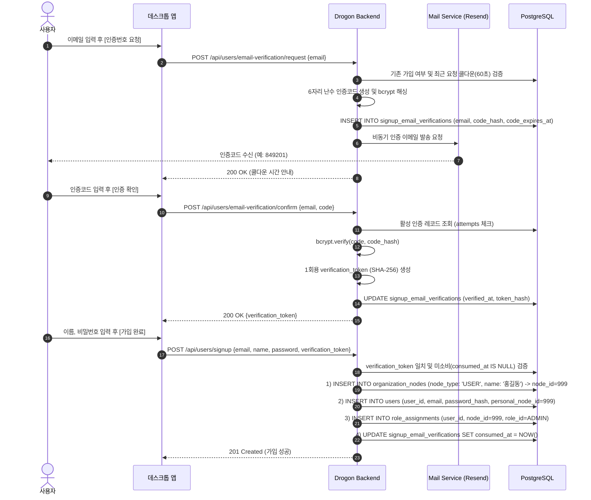

---

### 1.2. 로그인 및 대시보드 컨텍스트 초기화
로그인 성공 후 발급된 JWT로 사용자의 노드 트리, 비트마스크 권한, 초기 요약 통계를 단일 통합 API(`context/init`)로 가져옵니다.

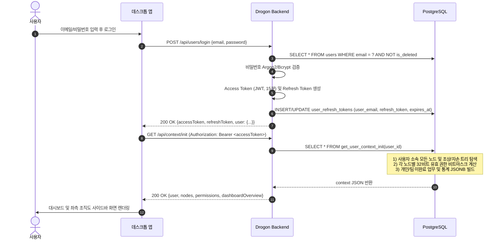

---

### 1.3. 무중단 JWT 토큰 갱신 (Token Refresh)
Access Token 만료(`401 Unauthorized`) 시 백그라운드 Axios 인터셉터를 통해 토큰을 회전(Rotate)합니다.

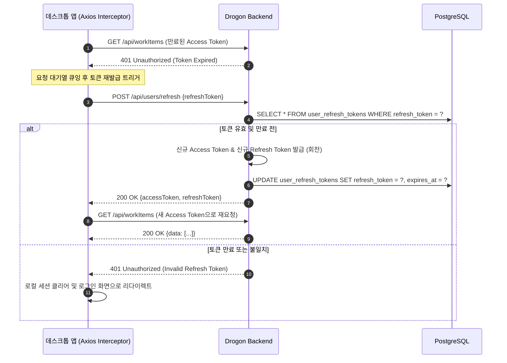

---

### 1.4. 비밀번호 재설정 (Password Reset)

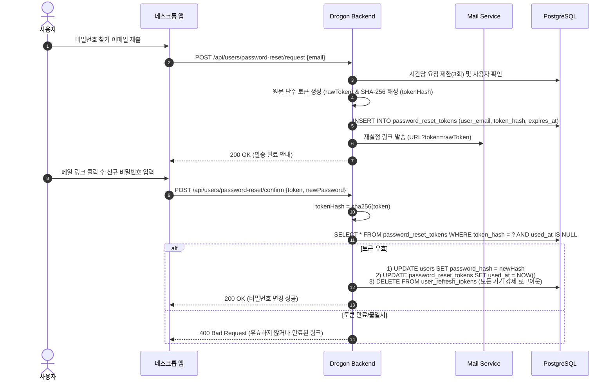

---

## 2. 조직 및 노드 트리 관리 (Organization & Nodes)

### 2.1. 최상위/하위 노드 생성 및 Path 자동 계산
노드 생성 시 부모의 `path` 배열을 이어받아 Materialized Path(`INTEGER[]`)를 자동으로 완성합니다.

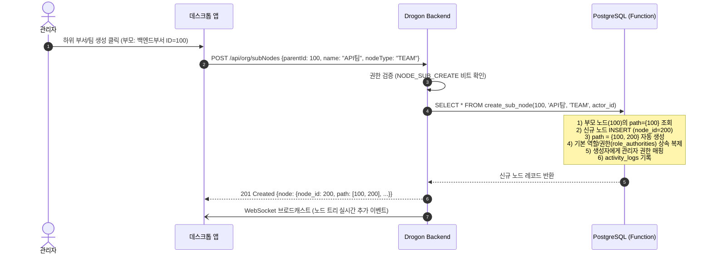

---

### 2.2. 노드 트리 이동 (Move Preview & 순환 참조 방지 이전)
노드를 다른 상위 노드 밑으로 이동할 때 순환 참조(자기 자신이나 자손을 부모로 지정) 여부를 사전에 검사한 뒤 일괄 이전합니다.

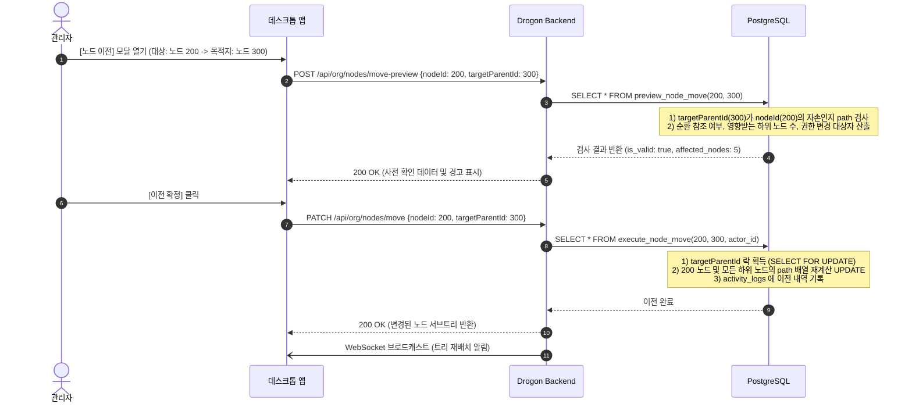

---

### 2.3. 노드 소프트 삭제 및 연쇄 비활성화 / 복구 무결성 검증

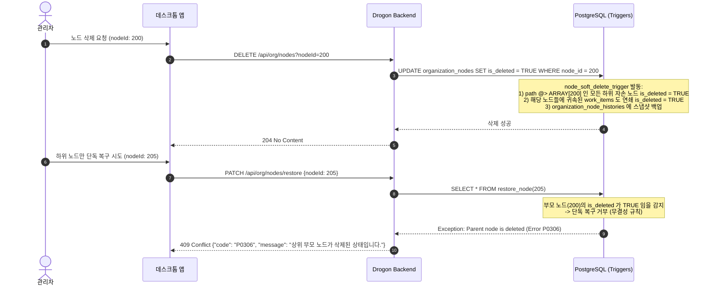

---

## 3. 역할 및 권한 관리 (Role & Authority)

### 3.1. 32비트 비트마스크 기반 커스텀 역할 생성 및 권한 검증

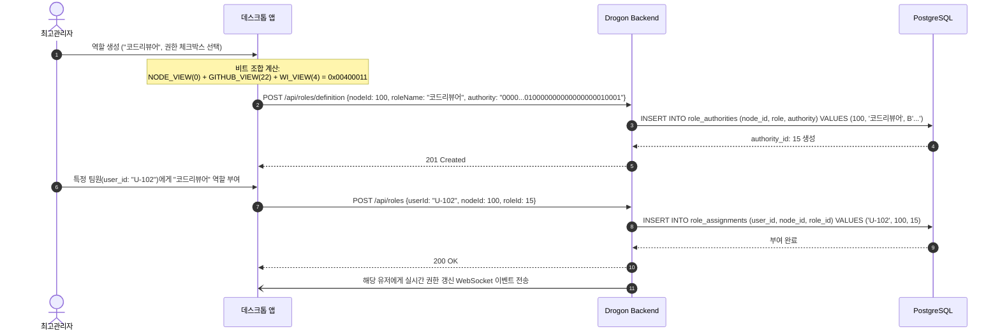

---

### 3.2. 역할 회수 사전 검사 (Removal Preview) 및 회수 처리
유일한 관리자의 권한을 회수하여 워크스페이스가 무관리자 상태(고아 상태)가 되는 사고를 방지합니다.

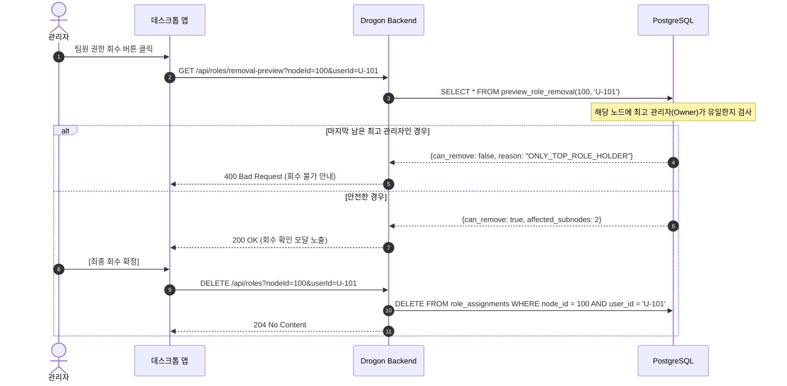

---

## 4. 업무 및 진행률 라이프사이클 (WorkItem & Tasks)

### 4.1. 업무 생성 및 가중치(Weight) 설정

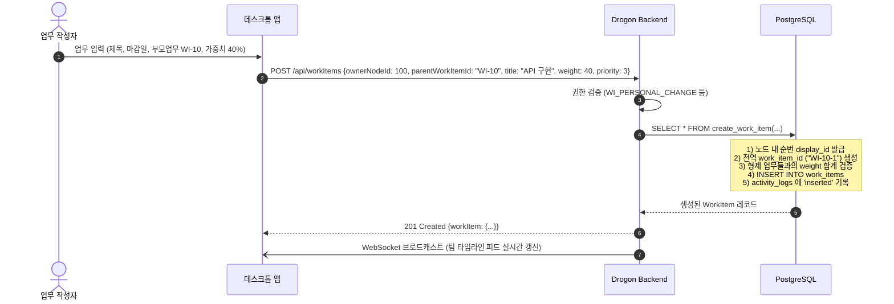

---

### 4.2. 하위 업무 완료 시 상위 프로젝트 진행률 자동 롤업 (Roll-up)
하위 태스크의 진행률이 바뀌면 PostgreSQL 트리거가 재귀적으로 상위 프로젝트의 진행률을 상향 재계산합니다.

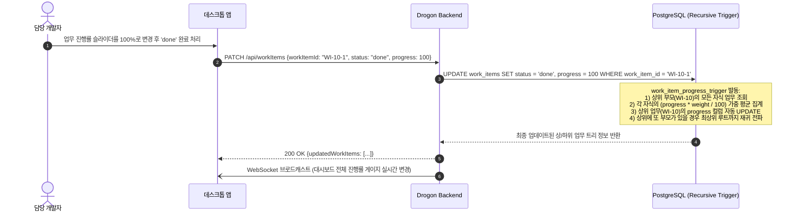

---

### 4.3. 업무 댓글 작성 및 멘션 실시간 웹소켓 알림

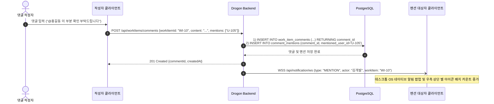

---

## 5. 정기 루틴 및 반복 업무 (Recurring Rules)

### 5.1. 정기 루틴 규칙 등록 및 WorkItem 자동 발급

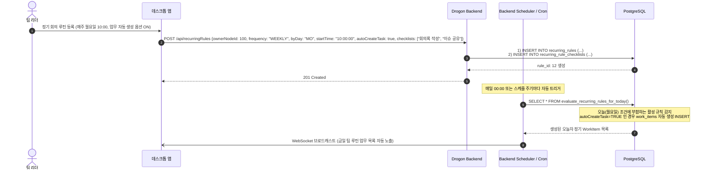

---

## 6. 실시간 채팅 및 채널 (Chat & Messaging)

### 6.1. 워크스페이스 채널 / 1:1 DM 생성 및 메시징

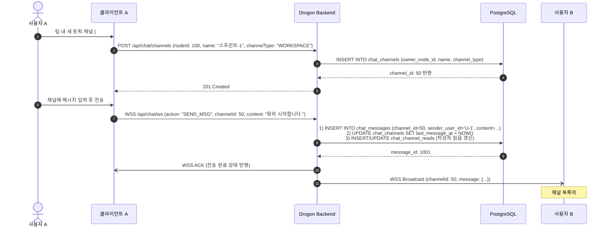

---

### 6.2. 1-Depth 스레드 답글 및 Unread 카운트 갱신

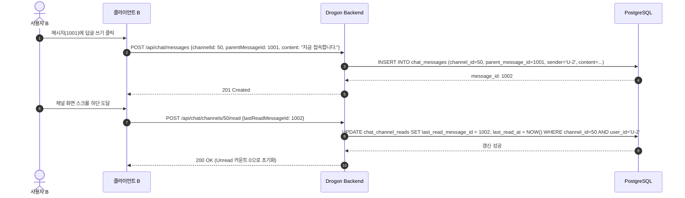

---

## 7. GitHub 연동 및 VSCode IDE 협업 (GitHub & IDE Integration)

### 7.1. GitHub 저장소 연동 및 로컬 클론/Worktree 준비

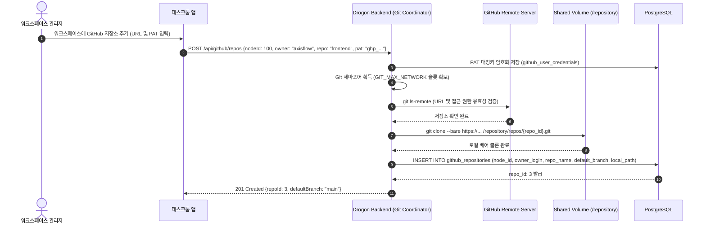

---

### 7.2. 앱 ↔ VSCode Extension 원클릭 핸드오프 (Handoff Code)
앱에서 특정 업무 카드의 [VSCode로 열기] 버튼을 누르면 1회용 티켓을 발급받아 VSCode를 자동으로 기동하고 확장 프로그램 세션을 연결합니다.

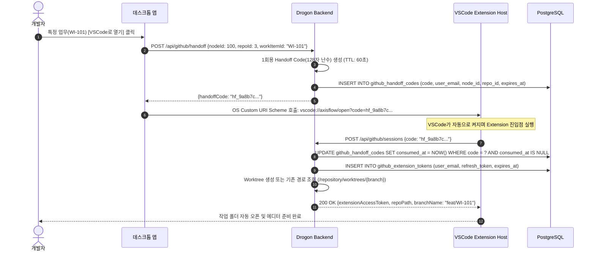

---

### 7.3. 실시간 동시 편집 (CRDT Y.Doc) 및 Worktree 원자적 파일 플러시
웹 브라우저/앱 내 에디터에서 여러 사용자가 같은 파일을 열고 실시간 협업할 때 발생하는 충돌 방지 및 디스크 동기화 흐름입니다.

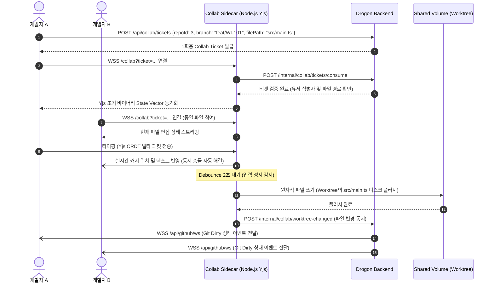

---

### 7.4. 웹 브라우저/앱 내 Git 스테이징, 커밋 및 원격 Push

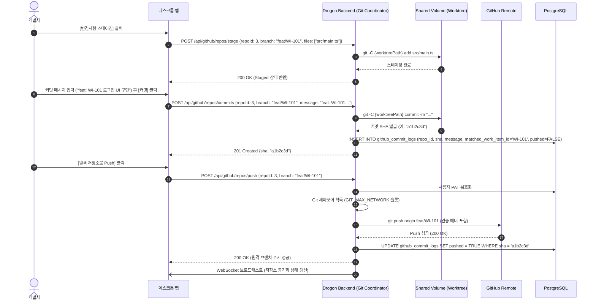
